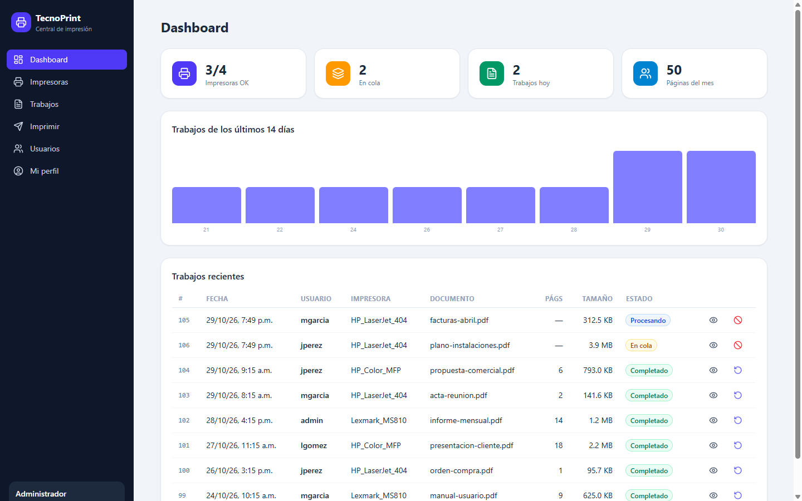
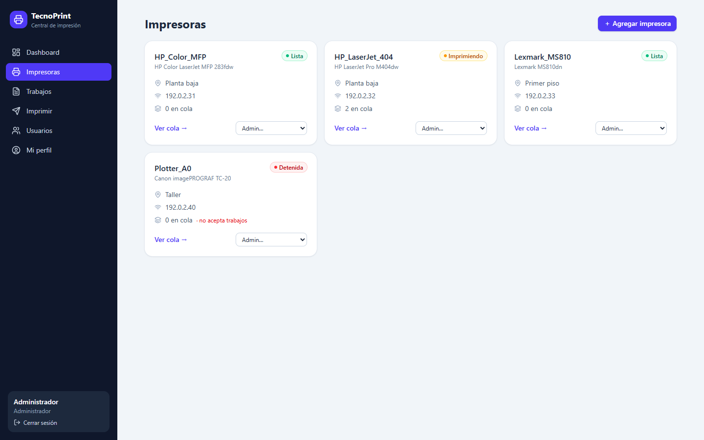
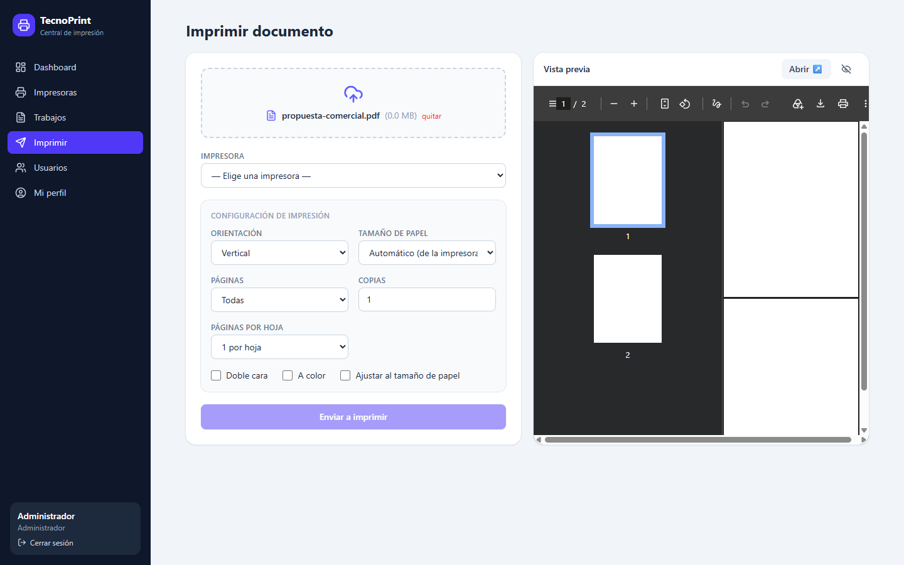
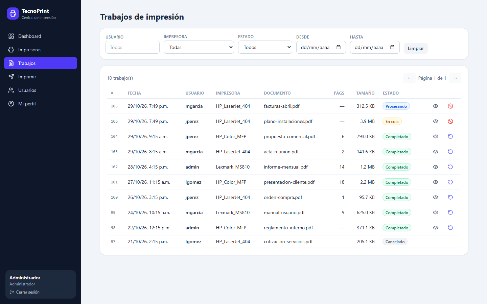
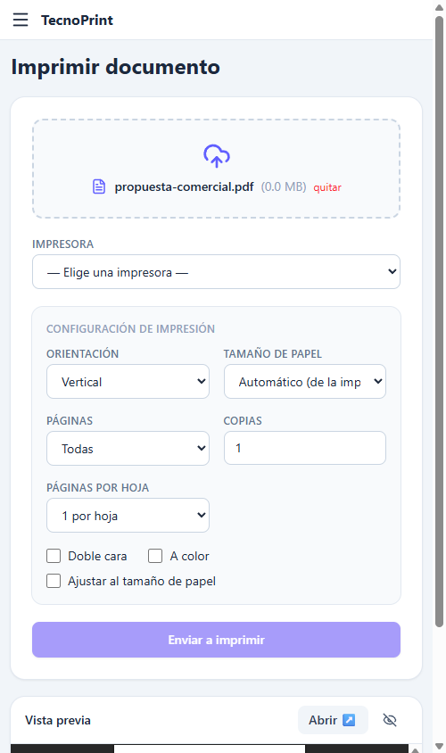

# TecnoPrint 🖨️

**Portal web de impresión centralizada sobre CUPS** — imprime desde el navegador, monitorea tus impresoras de red y audita quién imprimió qué, cuándo y con cuántas páginas. Sin instalar nada en las PCs de los usuarios.

     

## Capturas

| | |
|---|---|
|  |  |
| **Dashboard** — estado, trabajos y estadísticas | **Impresoras** — estado en vivo, IP, ubicación y acciones de admin |
|  |  |
| **Imprimir** — vista previa del PDF y opciones tipo Windows | **Trabajos** — auditoría con filtros y visor de documentos |

Responsive: 

## Características

- 🖨️ **Imprimir desde el navegador**: arrastra un PDF/Word/Excel/imagen, elige impresora y listo — sin drivers ni instaladores en el cliente.
- 👁 **Vista previa del PDF** antes de imprimir (local, sin subir nada).
- ⚙️ **Opciones de impresión** estilo diálogo de Windows: orientación, rangos de páginas (`1-3,8,10-15`, solo impares/pares), tamaño de papel, doble cara, color, ajustar a página, N páginas por hoja, copias.
- 📊 **Dashboard** con estado de impresoras, trabajos del día y estadísticas de páginas.
- 🔍 **Auditoría completa**: qué usuario imprimió qué documento, a qué impresora, cuándo, con **conteo real de páginas** y visor del documento original.
- 🔐 **Login con roles**: administradores gestionan impresoras y usuarios; los usuarios solo ven e imprimen.
- 🖨️ **Alta de impresoras desde el portal**: escaneo de red (`lpinfo`), driverless (IPP Everywhere), raw o PPD.
- 📱 **Responsive**: usable desde el celular.

## Arquitectura

```
        Navegador
            │  80/443
            ▼
        [ nginx ]  ──────────────── /            →  frontend React (estático, Vite build)
            │
            └── /api/*  ───────────►  [ API Fastify :3311 ]
                                          │
                        ┌─────────────────┼──────────────────┐
                        ▼                 ▼                  ▼
                   CupsAdapter        SQLite (better-   Sync cada 10 s
                   (local | ssh |     sqlite3): usuarios,  (lpstat → tabla
                    demo)             auditoría de jobs   jobs + páginas
                        │                                reales)
            ┌───────────┴────────────┐
            ▼                        ▼
     comandos CUPS               archivos CUPS
   lpstat · lp · cancel        page_log · spool
   lpadmin · lpinfo            (dNNNNN-001)
            │
            ▼
      [ cupsd :631 ]  ──►  impresoras de red (socket:// · ipp:// · dnssd://)
```

**La pieza clave es el `CupsAdapter`**: una interfaz única con tres implementaciones del mismo comportamiento:

| Modo | Cuándo | Cómo habla con CUPS |
|---|---|---|
| `local` | Producción (en el servidor) | Ejecuta `lpstat`/`lp`/`lpadmin` y lee `page_log` + spool del disco |
| `ssh` | Desarrollo desde tu PC | Los mismos comandos vía `ssh servidor` — desarrollas contra el CUPS real sin tocarlo |
| `demo` | Pruebas sin infraestructura | Datos ficticios en memoria (`DEMO=true`) |

Esto permite desarrollar el portal desde una laptop Windows y desplegar el mismo código en el servidor Linux sin cambios.

### El conteo real de páginas

CUPS no siempre puede contar las hojas de los trabajos que envían los clientes Windows (llegan como streams PJL/PCL XL). Solución:

1. Los trabajos enviados por el portal guardan sus **páginas exactas** (`pdfinfo` del documento al momento de imprimir).
2. Un *sync* cada 10 s completa retroactivamente los trabajos cuyo spool es PDF.
3. Los streams crudos de Windows muestran "—" (limitación documentada; el spool se conserva 60 días para vista previa y reimpresión).

## Tecnologías

| Capa | Stack |
|---|---|
| Frontend | React 19, Vite, TypeScript, Tailwind CSS, TanStack Query, React Router, lucide-react |
| API | Node.js, Fastify, TypeScript, JWT + bcrypt, better-sqlite3 |
| Impresión | CUPS 2.4 (comandos estándar), poppler-utils (`pdfinfo`), LibreOffice headless (opcional, para Office→PDF) |
| Producción | systemd + nginx (proxy estático + `/api`) |

## Levantar en desarrollo

Requisitos: Node 20+, y para el modo real: acceso a un servidor con CUPS (directo o por SSH) con `poppler-utils`.

```bash
# 1. Backend
cd backend
npm install
cp .env.example .env

# Opción A — ver el portal SIN impresora ni servidor (modo demo):
echo "DEMO=true" >> .env

# Opción B — contra un CUPS real por SSH (comandos vía ssh):
#   configura en .env:  CUPS_MODE=ssh  SSH_ALIAS=mi-servidor

npm run dev

# 2. Frontend (otra terminal)
cd frontend
npm install
npm run dev        # http://localhost:5173
```

Entra con **`admin` / `admin123`** (se crea automáticamente; cámbiala en *Mi perfil*).

Tests: `cd backend && npm test`

### Opciones principales del `.env`

| Variable | Valores | Descripción |
|---|---|---|
| `CUPS_MODE` | `local` / `ssh` | Dónde se ejecutan los comandos CUPS |
| `SSH_ALIAS` | alias de `~/.ssh/config` | Servidor al que conectarse en modo `ssh` |
| `CUPS_TARGET` | ej. `-h localhost:6320` | Apuntar a otra instancia de CUPS (dev) |
| `DEMO` | `true` | Datos ficticios, sin CUPS real |
| `DB_PATH` / `UPLOAD_DIR` | rutas | SQLite y archivos subidos |
| `MAX_UPLOAD_MB` | número | Tope de subida (default 50) |

## Producción

`deploy/` incluye la unidad systemd, el sitio de nginx (frontend estático + proxy `/api`) y un script de despliegue con confirmación y rollback. En el servidor se recomienda `apt install poppler-utils` y, si quieres imprimir Word/Excel desde el portal, `libreoffice` headless.

## Seguridad

- JWT (12 h) + bcrypt · rate-limit en el login.
- Roles: `admin` (gestiona impresoras y usuarios) y `user` (imprime y ve solo sus trabajos).
- Uploads con whitelist de tipos y tope de tamaño; archivos temporales se eliminan tras enviar a CUPS.
- Toda acción de administración se rechaza con 403 para usuarios sin rol.

## Estructura

```
backend/    API Fastify + adaptadores CUPS (local/ssh/demo) — 45 tests
frontend/   Portal React + Vite + Tailwind
deploy/     systemd, nginx y script de despliegue
docs/img/   capturas
```

## Licencia

[MIT](LICENSE)
